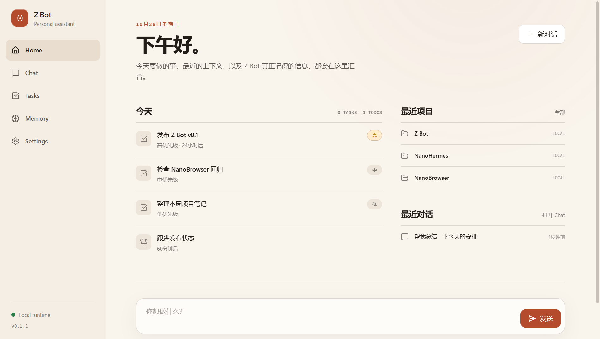
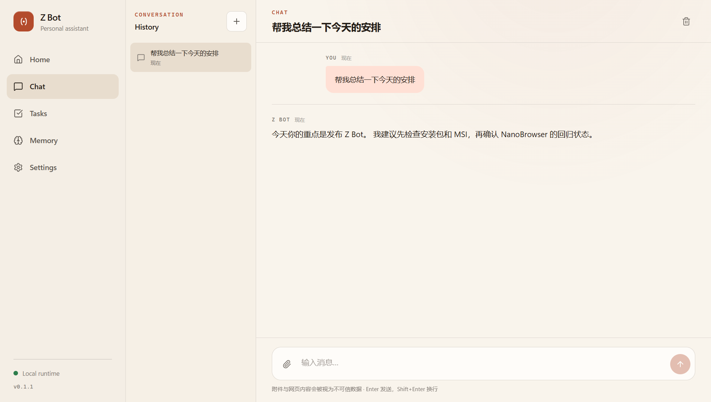
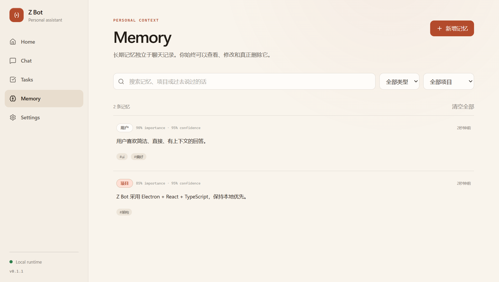
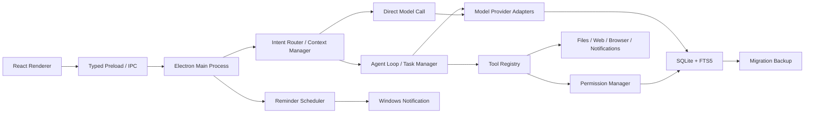

# Z Bot

> 一个运行在 Windows 电脑里的本地优先私人 AI 助理。

Z Bot 不是 Coding Agent，也不是通用聊天壳。它的核心是 **理解你、记住你、帮你处理日常事务，并在明确授权后行动**。

<p>
  
  
  
  
  
</p>

<p align="center">
  
</p>

<p align="center"><sub>界面截图使用示例数据，不包含真实用户内容。</sub></p>

## 目录

- [产品定位](#产品定位)
- [功能亮点](#功能亮点)
- [界面](#界面)
- [快速开始](#快速开始)
- [模型配置](#模型配置)
- [工具与权限](#工具与权限)
- [Memory 与项目上下文](#memory-与项目上下文)
- [本地 OCR 与图片](#本地-ocr-与图片)
- [项目停滞提醒](#项目停滞提醒)
- [架构](#架构)
- [目录结构](#目录结构)
- [安全与隐私](#安全与隐私)
- [数据存储与备份](#数据存储与备份)
- [开发](#开发)
- [测试](#测试)
- [打包](#打包)
- [GitHub Actions 发布](#github-actions-发布)
- [故障排查](#故障排查)
- [已知边界](#已知边界)
- [路线图](#路线图)
- [License](#license)

## 产品定位

Z Bot 的核心循环不是“用户问一句、模型答一句”，而是：

```text
Understand → Remember → Reason → Help → Act → Learn
```

它专注于：

- 理解当前请求和上下文；
- 记住真正有长期价值的信息；
- 把个人记忆、项目、任务和提醒组织成 Personal Context；
- 在授权范围内读取文件、读取网页、创建提醒和执行多步任务；
- 对高风险操作保持 Human-in-the-loop（人工确认）。

它不试图取代专业 Coding Agent。未来如果需要复杂软件开发，可以交给 NanoHermes 一类的专业 Agent，Z Bot 负责理解需求、派发工作、接收结果并提醒用户。

## 功能亮点

### 对话与模型

- OpenAI、OpenAI-compatible、Anthropic、Google、Ollama 配置。
- 支持 `general`、`fast`、`vision`、`reasoning` 等模型用途。
- 流式输出、Token 统计、模型重试、fallback 模型、5 分钟超时和全链路取消。
- 简单问题走单次模型调用，多步目标才进入 Agent Loop。
- 会话与消息持久化到本地 SQLite。

### 长期记忆

- User、Project、Event、Task、Global 五类 Memory。
- 独立于聊天记录，不会把全部历史消息塞进 Prompt。
- SQLite FTS5 中文检索、关键词 + 重要度/置信度/时间排序。
- 支持查看、编辑、搜索、永久删除、清空、过期归档。
- 支持“记住 X”“忘记 X”等显式操作。

### 个人事务

- Todo：优先级、截止时间、完成状态。
- Reminder：一次、每天、每周；Windows 通知、点击跳转。
- Project：项目目标、描述、目录与 Project Memory 组织。
- 项目停滞提醒：结合文件时间、对话、记忆和任务活动综合判断。
- Home 每日简报：今天的待办、提醒、最近项目和最近对话。

### 工具与 Agent

- 文件读取、搜索、创建目录、复制、移动、批量移动、写入、Recycle Bin 删除。
- Web 搜索（Tavily / Brave）、网页正文提取、浏览器读取与交互。
- Memory、Todo、Reminder 工具。
- 剪贴板文本读取、屏幕截图。
- Agent 任务步骤、工具调用卡、验证结果、停止按钮和任务历史。
- 任务和应用退出安全暂停：重启后不会自动重放可能产生副作用的中断任务。

### Windows 桌面集成

- 托盘常驻、系统通知、开机启动、关闭时最小化。
- `Ctrl + Space` 唤起 Quick Ask。
- `Ctrl + Shift + Z` 截取主屏幕并附加到 Chat。
- 单实例运行、快速任务窗口、CSP 和 renderer 沙箱。

## 界面

### Chat

<p align="center">
  
</p>

- 左侧保存本地会话历史。
- 中间显示流式回复、工具调用和任务进度。
- 支持图片/文件附件、拖动、粘贴和截图。
- 运行中的任务可以随时停止。

### Memory

<p align="center">
  
</p>

- 搜索、类型筛选、项目筛选。
- 展示来源、重要度、置信度、标签和更新时间。
- 所有记忆都可以编辑或永久删除。

### Home / Tasks / Settings

- **Home**：Today、Recent Projects、Recent Conversations 和 Quick Ask。
- **Tasks**：历史任务、步骤、统计、错误、取消。
- **Settings**：AI、Memory、Tools、Permissions、Projects、Notifications、Privacy、Shortcuts、Appearance。

## 快速开始

### 环境要求

- Windows 10/11（主要在 Windows 11 验证）
- Node.js 22+，推荐 Node.js 24
- pnpm 11+
- 可选：Ollama，或任意兼容 OpenAI Chat Completions 的服务

### 从源码运行

```powershell
# 进入项目目录
pnpm install
pnpm dev
```

首次启动后按顺序配置：

1. **Settings → AI**：添加模型。
2. **Settings → Tools**：可选配置 Web 搜索 Key。
3. **Settings → Permissions**：添加允许访问的目录。
4. **Settings → Projects**：创建项目并决定是否开启停滞提醒。

### 使用已构建版本

从 `release/` 运行：

```text
Z-Bot-<version>-Portable.exe
Z-Bot-<version>-x64.msi
```

portable 版本无需安装；MSI 会安装到 Windows 应用目录。当前构建未签名，SmartScreen 可能提示未知发布者。

## 模型配置

### 本地 Ollama

```text
Kind:      Ollama
Base URL:  http://127.0.0.1:11434/v1
Model:     llama3.2（或已安装的其他模型）
API Key:   留空
用途:       general
```

先确认本机 Ollama 正在运行：

```powershell
ollama list
ollama serve
```

### OpenAI

```text
Kind:      OpenAI
Model:     你的模型 ID
API Key:   从 OpenAI 控制台获取
```

### OpenAI-compatible / OpenRouter / LM Studio

```text
Kind:      OpenAI-compatible
Base URL:  服务商提供的 /v1 地址
Model:     服务商模型 ID
API Key:   按服务商要求填写
```

### Anthropic / Google

选择对应的原生 Provider 和模型 ID，填写 API Key。图片分析需要选择支持视觉输入的模型，并把用途设为 `vision`。

### 模型用途与 fallback

- 每种用途可以配置一个默认模型。
- 没有单独配置 `vision` 时会回退到 `general`。
- 主模型重试失败后，会尝试同用途或 general 中另一个已配置模型。
- API Key 使用 Windows DPAPI（Electron `safeStorage`）加密，保存后不会回显给 Renderer。

## 工具与权限

### 工具清单

| 分类 | 工具 |
|---|---|
| 文件 | `list_directory`, `read_file`, `search_files`, `create_directory`, `copy_file`, `move_file`, `move_files`, `write_file`, `trash_file` |
| 网络 | `web_search`, `web_fetch`, `browser_navigate`, `browser_extract_text`, `browser_click`, `browser_type`, `browser_screenshot` |
| 个人 | `remember`, `search_memory`, `forget_memory`, `create_todo`, `create_reminder` |
| 系统 | `get_clipboard`, `capture_screen` |

### 默认权限策略

| 操作 | 默认 |
|---|---|
| 读取授权目录内文件 | 允许 |
| Web 搜索 / 网页只读 | 允许 |
| 创建 Todo / Reminder | 允许 |
| 写入、移动、复制文件 | 询问 |
| 批量移动 | 询问，展示完整来源/目标预览 |
| 文件移入 Recycle Bin | 询问 |
| 浏览器点击、输入、提交 | 询问 |
| 浏览器截图 | 询问 |
| 读取剪贴板 | 询问 |
| 截取屏幕 | 询问 |
| 读取系统 Secret | 不提供 |
| 任意 Shell / 自动付款 / 自动登录 / 自动发消息 | 不提供 |

权限确认支持：

- **允许一次**
- **允许此类操作**（按工具 + 规范化范围持久化）
- **拒绝**

### 文件访问边界

- 只接受绝对路径。
- 路径会经过规范化与 `realpath`，阻止 `..`、符号链接/Junction 逃逸。
- 拒绝设备路径和磁盘根目录。
- 拒绝 Windows、Program Files 等系统目录授权。
- 目标目录必须位于 **Settings → Permissions** 的授权根目录内。
- 写入使用临时文件 + 校验；移动会验证源已移除、目标存在且哈希一致。

### Prompt Injection 边界

以下内容始终按 `UNTRUSTED_DATA` 处理：

- Web 搜索与网页正文；
- 文件内容与文件列表；
- 浏览器页面内容；
- 图片 OCR 文本；
- 其他工具返回结果。

工具结果不能覆盖 System Prompt。即使网页要求“忽略之前的指令”，Z Bot 仍会经过权限层和工具边界。

## Memory 与项目上下文

Memory 不是聊天记录，而是经过筛选的长期信息。

### Memory 类型

| 类型 | 用途 |
|---|---|
| `user` | 偏好、习惯、常用工具、界面偏好 |
| `project` | 项目目标、技术栈、重要决策 |
| `event` | 项目/任务/提醒产生的重要事件 |
| `task` | 任务结论、验证结果 |
| `global` | 不属于具体项目的长期信息 |

### 写入策略

- 用户明确说“记住……”一定进入 Memory。
- Agent 只有在信息稳定、长期有用时才应调用 `remember`。
- **Settings → Memory** 可以关闭自动调用 `remember`；显式记忆不受影响。
- 默认过期天数可配置；留空表示长期保留。
- 过期 Memory 会归档，不参与普通检索。
- 删除是真正的硬删除。

### 上下文构建

每次请求只加载与当前问题相关的部分：

```text
System rules
+ 当前用户请求
+ 当前 Task
+ 工具结果
+ 相关 Memory
+ 项目上下文
+ 最近对话
```

不会把全部历史聊天或全部 Memory 直接发送给模型。

## 本地 OCR 与图片

- 使用 Windows 原生 `Windows.Media.Ocr`，不依赖 Tesseract 或第三方 OCR 云服务。
- 支持图片粘贴、拖入、选择文件、截图。
- 中英文识别取决于 Windows 已安装的 OCR 语言组件。
- OCR 文本会写入当前请求的 `<untrusted_image_text>` 区块，再交给模型。
- 如果本地 OCR 失败，会自动回退到已配置的 Vision 模型；不会阻断请求。
- 可在 **Settings → Tools → 本地 OCR** 关闭。

## 项目停滞提醒

项目停滞提醒不是“每天固定推送”，而是基于真实活动计算：

- 项目更新时间；
- 项目目录修改时间（仅当目录在授权范围内）；
- 关联会话的最后更新时间；
- 关联 Memory 的最后更新时间；
- 关联 Task 的最后更新时间。

行为：

- 默认关闭。
- **Settings → Notifications** 开启“项目停滞提醒”并设置阈值，默认 7 天。
- **Settings → Projects** 为具体项目开启“停滞提醒”。
- 启动后 10 秒检查一次，之后每 6 小时检查。
- 同一停滞周期只提醒一次；项目恢复活动后，下一轮停滞可以再次提醒。
- 点击通知打开 Memory 页面。

## 架构



### 数据流

1. Renderer 通过 preload 调用类型化 IPC。
2. 主进程校验参数、写入用户消息，创建 `requestId` 和 `AbortController`。
3. Intent Router 判断直接回答、单工具还是多步 Agent。
4. Context Manager 按预算加载相关 Memory、项目和历史。
5. 模型流式返回文本或 Tool Call。
6. Tool 先经过权限与路径/URL 边界，再执行和验证。
7. 事件实时推送到 UI；停止时中止模型、工具、浏览器和权限等待。
8. 回复完成后才按需写入 Memory。

### 关键约束

- 主进程独占数据库、密钥、工具执行和系统能力。
- Renderer 没有 Node.js 权限。
- IPC 只暴露显式白名单方法，并使用 Zod 校验。
- Tool Result 永远不等于 System Instruction。
- 模型不能直接把“完成”当成事实，工具需要返回验证结果。

## 目录结构

```text
z-bot/
├─ apps/desktop/
│  ├─ electron/
│  │  ├─ main/                 # 生命周期、服务组装
│  │  ├─ preload/              # contextBridge API
│  │  ├─ ipc/                  # 校验后的 IPC handlers
│  │  └─ services/             # OCR、Scheduler、Proactive、Secrets、Tray...
│  ├─ renderer/src/
│  │  ├─ app/                  # App Shell、路由
│  │  ├─ pages/                # Home / Chat / Tasks / Memory / Settings / Quick Ask
│  │  ├─ components/           # Markdown、Tool Card、Permission Dialog...
│  │  └─ stores/               # Chat / Settings Zustand stores
│  └─ resources/               # 图标、OCR 脚本
├─ packages/
│  ├─ shared/                  # 领域类型、Zod schema、IPC contract
│  ├─ database/                # node:sqlite、迁移、FTS5、stores
│  ├─ model/                   # 多 Provider 适配与统一流式事件
│  ├─ memory/                  # Memory 写入、检索、去重、格式化
│  ├─ tools/                   # Tool Registry、路径守卫、文件/Web/浏览器
│  └─ bot-core/                # Context、Intent、Permission、Agent、Runtime
├─ tests/e2e/                  # Electron + 本地 SSE 模型服务器 E2E
├─ scripts/                    # 冒烟、截图、OCR 验证脚本
├─ .github/
│  ├─ scripts/bump-version.mjs
│  └─ workflows/release.yml
├─ pnpm-workspace.yaml
├─ pnpm-lock.yaml
└─ README.md
```

## 安全与隐私

### 本地优先

- 没有 Z Bot 自有云端。
- 不启用 telemetry。
- 对话、Memory、任务、权限、日志和附件保存在本机。
- 只有你配置的模型服务商、搜索服务商和网页目标会收到对应数据。

### 密钥保护

- API Key 使用 Windows DPAPI 加密保存。
- Renderer 只能看到“是否已配置密钥”，不能读取密钥。
- 日志对 Key、Token、Password、Cookie、Authorization 等字段脱敏。
- 如果系统安全存储不可用，Z Bot 会拒绝以明文保存密钥。

### 进程隔离

- `contextIsolation: true`
- `nodeIntegration: false`
- `sandbox: true`
- 严格 CSP
- 拒绝任意窗口打开与未授权导航
- 权限请求默认拒绝

### 网络边界

- `web_fetch` 只允许 `http/https`。
- 阻止 localhost、私有 IP、链路本地地址和内部域名。
- 重定向会逐跳校验。
- 响应体有大小限制。
- Browser 工具默认不下载文件，自动关闭弹窗。

## 数据存储与备份

默认目录：

```text
%APPDATA%\ZBot\
├─ zbot.db            # SQLite 主数据库（WAL）
├─ backups\           # 结构升级前的自动备份
├─ attachments\       # 图片与附件
├─ logs\              # 脱敏日志
├─ GPUPersistentCache\
└─ ShaderCache\
```

开发/测试可以用环境变量覆盖用户数据目录：

```powershell
$env:ZBOT_USER_DATA_DIR = "D:\temp\zbot-profile"
pnpm dev
```

### 备份

完全退出 Z Bot 后，复制整个 `%APPDATA%\ZBot` 目录即可备份。数据库升级前会额外写入 `backups/`。

### 重置

先备份数据，再删除或重命名 `%APPDATA%\ZBot`。这会移除对话、Memory、权限、提醒和设置，操作不可撤销。

### 日志

- 按日期分文件写入 `logs/`。
- 启动和更新设置时会清理超过保留天数的日志。
- 日志只记录操作元数据，不主动记录 Prompt 正文。
- **Settings → Privacy** 可调整日志级别和保留天数。

## 开发

### 常用命令

| 命令 | 作用 |
|---|---|
| `pnpm dev` | 启动 Electron 开发模式 |
| `pnpm build` | Typecheck + Electron/Vite 构建 |
| `pnpm typecheck` | Node 与 Renderer TypeScript 检查 |
| `pnpm lint` | ESLint |
| `pnpm test` | Vitest 单元/集成测试 |
| `pnpm test:watch` | Vitest watch |
| `pnpm test:e2e` | 构建后运行 Playwright Electron E2E |
| `pnpm package:win` | 生成 portable EXE |
| `pnpm package:release` | 生成 portable EXE + MSI |
| `pnpm --filter @zbot/desktop package:nsis` | 可选 NSIS 安装包 |

### 技术栈

- Electron 45
- React 19 + React Router
- TypeScript 6
- Vite 8 + electron-vite
- Tailwind CSS 4 + Radix UI
- Zustand
- `node:sqlite` + FTS5
- Vercel AI SDK Provider 适配
- playwright / Playwright Electron
- Vitest
- pnpm workspace

### 开发约定

- 每个模块独立实现并立即验证。
- 修改后至少运行 `pnpm typecheck`、相关测试和 `pnpm build`。
- 不使用 TODO 或 mock 假装功能已完成。
- 生产环境不使用假模型；测试使用本地 OpenAI-compatible SSE 服务器走真实适配层。
- 涉及权限、路径、URL、密钥的修改必须补测试。

## 测试

当前测试基线：

- **32 个单元/集成测试**
- **2 个 Electron E2E**

覆盖范围包括：

- SQLite 迁移、Setting、Conversation、Task、Todo、Reminder、Project；
- Memory 中英文检索、删除、过期与项目活动；
- 路径遍历、Junction 逃逸、文件写入/批量移动验证；
- SSRF、localhost/私网拦截；
- 模型流式 SSE、工具调用解析；
- Agent 工具执行、验证、用户拒绝权限；
- 本地 OCR 文本进入模型上下文；
- Electron 真实窗口、IPC、流式回复和 Memory 持久化；
- 项目停滞提醒与去重。

运行：

```powershell
pnpm typecheck
pnpm lint
pnpm test
pnpm test:e2e
```

## 打包

### 产物

| 产物 | 说明 |
|---|---|
| `Z-Bot-<version>-Portable.exe` | 无需安装，直接运行 |
| `Z-Bot-<version>-x64.msi` | Windows Installer |
| `Z-Bot-<version>-Setup.exe` | 可选 NSIS，需单独执行 |
| `SHA256SUMS.txt` | Release 自动生成 |

### 本地打包

```powershell
pnpm package:release
```

产物位于 `release/`。

当前机器上 NSIS 可能因为杀软锁定 uninstaller 生成而失败，因此自动发布只包含 portable EXE 和 MSI。

## GitHub Actions 发布

工作流：`.github/workflows/release.yml`

### 触发方式

- **Pull Request**：完整测试，不发布。
- **主分支 push**：完整测试通过后自动 bump `patch` 版本、提交版本变更、创建并推送 tag，然后构建并发布。
- **推送 `v*` tag**：按 tag 版本构建并创建/更新 GitHub Release，不再递增版本。
- **手动运行 Test and Release Windows**：
  1. 选择 `patch` / `minor` / `major`；
  2. 自动更新版本号；
  3. 提交版本变更；
  4. 创建并推送 tag；
  5. 构建 EXE/MSI；
  6. 创建或更新 Release。

### Release 资产

```text
Z-Bot-<version>-Portable.exe
Z-Bot-<version>-x64.msi
SHA256SUMS.txt
```

### 权限

工作流使用内置 `GITHUB_TOKEN`，release job 声明：

```yaml
permissions:
  contents: write
```

checkout 会保留凭据，因此版本提交和 tag 可以直接推送，不需要额外 PAT。若仓库启用了分支保护或 ruleset，需要在 GitHub 仓库设置中允许 Actions 推送。

## 故障排查

### 提示“还没有配置模型”

进入 **Settings → AI** 添加模型。OpenAI-compatible 必须填写 Base URL。

### Ollama 连接失败

```powershell
ollama serve
ollama list
```

确认 Base URL 为 `http://127.0.0.1:11434/v1`，模型 ID 与 `ollama list` 一致。

### 模型返回 401 / 403

重新输入 API Key。保存后界面只显示“已配置”，不会回显密钥。

### Web 搜索没有结果

- 在 **Settings → Tools** 配置 Tavily 或 Brave Key。
- 确认所选 Provider 与 Key 类型一致。
- 搜索服务商配额耗尽时会在工具卡中显示错误。

### 浏览器工具启动失败

优先会自动使用 Microsoft Edge。如果系统没有 Edge，安装 Chromium：

```powershell
pnpm exec playwright install chromium
```

### OCR 没有文字

Windows 需要安装 OCR 语言组件。检查 **Windows 设置 → 时间和语言 → 语言和区域**，安装中文/英文语言功能及光学字符识别组件。

### 没有收到通知

- 检查 **Settings → Notifications**。
- 检查 Windows 专注助手 / 勿扰模式。
- Reminder 只在 Z Bot 仍在托盘运行时触发。

### 快捷键无效

`Ctrl + Space` 可能被输入法或其他应用占用。当前快捷键尚未提供自定义 UI。

### NSIS 打包失败

本机可能遇到卸载器文件被杀软锁定。使用 portable 或 MSI；自动发布不依赖 NSIS。

### GitHub Release 没有创建

检查：

- Release job 是否获得 `contents: write`；
- 默认分支是否允许 Actions 推送；
- tag 是否为 `v*`；
- Actions 日志中测试或打包是否失败。

## 已知边界

- 不提供任意 Shell、无限 Computer Use、自动登录、付款或自动发消息。
- Reminder 只在应用/托盘运行时触发；完全退出后不依赖系统后台服务补发。
- 本地 OCR 依赖 Windows OCR 语言组件。
- 项目停滞提醒默认关闭，需要全局开关和项目开关同时开启。
- Push-to-talk 语音输入尚未接入。
- Embedding / 向量检索入口尚未启用，v0.1 检索基线是 FTS5。
- 没有客户端自动更新器；发布工作流只更新 GitHub tag 和 Release。
- 不支持多用户、云同步、移动端或插件市场。
- 安装包未签名，可能出现 SmartScreen 提示。

## 路线图

- 语音输入与 Push-to-talk。
- Embedding + sqlite-vec 混合检索。
- 文件 Watcher 与更丰富的 Proactive Engine。
- Calendar / GitHub / Email 等事件源。
- 加密同步与移动端。
- 代码签名、自动更新器和更细粒度的发布渠道。
- 可选专业 Agent 协作（例如 NanoHermes）。

## License

当前仓库未包含 `LICENSE` 文件。在补充明确许可证之前，默认保留所有权利。如需开源发布，请先添加合适的许可证。
